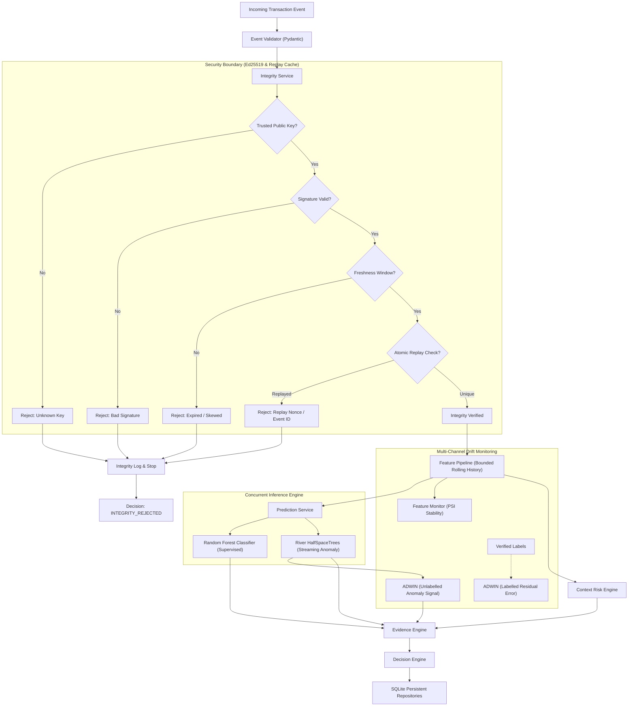

# SHIFT — Streaming Hybrid Intelligence for Fraud Tracking
*(DRIFTGUARD 2.0 Engine · The Moving Target Hackathon Solution)*

> **"Somewhere in a stream of transactions, a few people are stealing. They read your alerts. At some moment today they will change how they steal, and no one will tell you. Missing one thief costs as much as bothering fifty honest customers. Know when the world changed, before the answers arrive, and say how you know."**

SHIFT is an enterprise-grade streaming fraud detection intelligence platform designed to solve **The Moving Target** problem: detecting changes in adversarial behaviour **before ground-truth chargebacks or labels arrive**, using unlabelled streaming anomaly signals and multi-feature Population Stability Index (PSI) forensics.

Built with a high-performance **FastAPI** backend (Python 3.14) and a **Next.js 14 App Router** frontend (React 18, TypeScript, Tailwind CSS, Apache ECharts, TanStack Query v5, and WebSockets).

Designed with a **Premium White Financial Intelligence Aesthetic**, it provides deep observability across **11 core navigation modules**, powered by a **7-Specialist Multi-Expert Detection Architecture**, transparent **Risk Fusion Engine**, and an empirical **Moving Target Observatory**.

---

## 🚀 Quick Start — Launching SHIFT

### Step 1: Start the FastAPI Backend
```bash
# From workspace root (D:\project\HACKATHONAI)
python -m uvicorn backend.main:app --host 127.0.0.1 --port 8000 --reload
```
- **API Documentation (Swagger UI)**: [http://127.0.0.1:8000/docs](http://127.0.0.1:8000/docs)
- **Live WebSocket Server**: `ws://127.0.0.1:8000/ws/v1/events`

### Step 2: Start the Next.js Frontend
```bash
# In a second terminal
cd frontend
npm run dev
```
- **Web Platform**: [http://localhost:3000](http://localhost:3000)

### Step 3: Run the Moving Target Experiment
```bash
# In a terminal: executes the 6-phase moving target simulation
python scripts/run_moving_target_experiment.py
```

### Step 4: Run the Full Test Suite (57 Tests)
```bash
python -m pytest tests/ -v
```

---

## 🏛️ Comprehensive Architecture & Governance Reports

All comprehensive design and validation documents are located in `reports/`:

| Report | Purpose |
|--------|---------|
| [`reports/IMPLEMENTATION_AUDIT.md`](reports/IMPLEMENTATION_AUDIT.md) | Component-by-component audit classifying every module (Implemented/Partial/Missing). |
| [`reports/FINAL_ARCHITECTURE.md`](reports/FINAL_ARCHITECTURE.md) | Complete multi-tier architecture, dataflow mermaid diagrams, tech stack, and deployment specs. |
| [`reports/ALGORITHM_DESIGN.md`](reports/ALGORITHM_DESIGN.md) | Mathematical foundation of Half-Space Trees, ADWIN unlabelled drift, PSI, and Risk Fusion. |
| [`reports/DATA_PROVENANCE.md`](reports/DATA_PROVENANCE.md) | Strict separation between IEEE-CIS historical benchmark and synthetic UPI streaming environments. |
| [`reports/MOVING_TARGET_EXPERIMENT.md`](reports/MOVING_TARGET_EXPERIMENT.md) | Empirical 6-phase experiment proof: detecting tactic pivots in 7 events without labels. |
| [`reports/VALIDATION_RESULTS.md`](reports/VALIDATION_RESULTS.md) | 57/57 pytest test suite log, IEEE-CIS ROC-AUC 0.8954 benchmark, and Next.js build stats. |
| [`reports/KNOWN_LIMITATIONS.md`](reports/KNOWN_LIMITATIONS.md) | Honest assessment of edge cases, Windows async loops, and architectural guardrails. |
| [`reports/JUDGE_DEMO_SCRIPT.md`](reports/JUDGE_DEMO_SCRIPT.md) | Step-by-step 5-7 minute demonstration sequence with click paths and verbal scripts. |
| [`reports/INNOVATION_AND_DIFFERENTIATION.md`](reports/INNOVATION_AND_DIFFERENTIATION.md) | Competitive comparison against legacy rule engines and naive auto-retraining systems. |

---

## 🖥️ 11 Core Platform Modules

| # | Module Name | Core Capabilities |
|---|-------------|-------------------|
| **1** | **Command Centre** | Real-time KPI deck, 3-tier action breakdown (Allow/Review/Block), dual-axis streaming risk trends, and recent forensic alert feed. |
| **2** | **Live Transactions** | Real-time virtualized transaction ledger, search filters, and slide-over drawer for deep cryptographic payload inspection. |
| **3** | **Fraud Investigations** | Case queue for flagged transactions, correlated device/sender timeline, evidence breakdown, and analyst adjudication actions. |
| **4** | **Entity Intelligence** | Interactive Apache ECharts Knowledge Graph visualizing senders, receivers, devices, locations, and detected mule rings. |
| **5** | **Multi-Expert Detection** | 7 specialist models, multi-dimensional radar comparison, dynamic weight calibration, and interactive what-if simulator. |
| **6** | **Adaptive Response** | Enforced autonomous remediation policies, threshold adjustment simulator, and active entity allowlist/blocklist. |
| **7** | **Model Observatory** | Authentic IEEE-CIS benchmark provenance (Holdout ROC-AUC 0.8954), confusion matrix, p50/p95/p99 latency, and feature importances. |
| **8** | **Drift Analytics** | River ADWIN unlabelled drift and labelled concept drift monitors, feature PSI table, and quantile distribution comparisons. |
| **9** | **Simulation Studio** | Operator control deck (Start/Pause/Step/Reset), 19 scenario definitions, attack injection lab, and CSV transaction export. |
| **10** | **Moving Target Lab** | **Core Hackathon Feature**: Interactive 6-phase experiment runner, ADWIN change-point detector, and feature-level PSI drift evidence. |
| **11** | **Data & System Settings** | Hardware health check, Ed25519 cryptographic key registry, and SQLite database storage volume breakdown. |

---

# Phase 1 & 2 Historical Documentation



---

## 2. Core Capabilities

1. **Cryptographic Integrity & Replay Protection**:
   - Ed25519 digital signatures using canonical JSON payload byte serialization (strictly excluding the `signature` field).
   - Time-window freshness enforcement (`MAX_EVENT_AGE_SECONDS = 300s`).
   - Atomic database-backed deduplication on `(key_id, nonce)` and `event_id` in SQLite.
   - Immediate termination before ML pipelines upon signature tampering or replay.

2. **Temporal & Contextual Feature Pipeline**:
   - Real-time rolling metrics: transaction amounts, log-transforms, amount deviations, z-scores.
   - Velocity tracking: 60-second sliding windows, time since previous event per device/entity.
   - Context consistency: device fingerprint switches, session duration, ASN changes, VPN indicators.
   - Strictly chronological processing with zero lookahead leakage.

3. **Multi-Tier Machine Learning**:
   - **Supervised Baseline**: Random Forest with class-imbalance weighting (`balanced`), reporting Precision, Recall, F1, ROC-AUC, and PR-AUC.
   - **Incremental Adapter**: `SGDClassifier` (`log_loss`) with partial-fit scaling for verified retraining batches.
   - **Streaming Anomaly Detection**: `river.anomaly.HalfSpaceTrees` operating over sliding reference windows, maintaining streaming tree state.
   - **Offline Benchmark**: `IsolationForest` baseline for comparison.

4. **Multi-Channel Drift Detection**:
   - **ADWIN Channel A (Unlabelled)**: Tracks statistical shifts in streaming anomaly scores.
   - **ADWIN Channel B (Labelled)**: Flags true concept drift upon significant changes in verified prediction residual errors $|y_{true} - \hat{y}|$.
   - **PSI Feature Monitor**: Evaluates Population Stability Index across continuous feature windows ($PSI > 0.20$ indicates significant drift).
   - **Strict Independence**: Data drift is never conflated with concept drift, and drift alerts never automatically inflate normal transaction risk.

5. **Decision & Evidence Matrix**:
   - Ratings: `NORMAL`, `MONITOR`, `REVIEW`, `HIGH_RISK`, `INTEGRITY_REJECTED`.
   - Produces auditable, human-readable evidence items without hallucinated contributions.

---

## 3. Project Directory Structure

```
DRIFTGUARD/
├── app.py                      # CLI orchestration entrypoint
├── config.py                   # Centralized configuration (paths, thresholds, keys)
├── requirements.txt            # Python dependencies
├── .env.example                # Sample environment variables
├── .gitignore                  # Git ignore rules
├── README.md                   # System documentation
│
├── data/
│   ├── raw/                    # Raw external datasets (ULB, IEEE-CIS)
│   ├── processed/              # Preprocessed split datasets
│   └── simulated/              # Deterministic synthetic benchmark CSVs
│
├── ingestion/
│   ├── event_schema.py         # Pydantic TransactionEvent schema
│   ├── event_generator.py      # StreamEventGenerator with Ed25519 signing
│   ├── dataset_loader.py       # Multi-format benchmark dataset loader
│   ├── stream_processor.py     # Streaming playback and dispatch
│   └── validator.py            # Deserialization and validation guards
│
├── security/
│   ├── key_manager.py          # Ed25519 key lifecycle and keystore
│   ├── signature_verifier.py   # Canonical payload signing & verification
│   ├── replay_protection.py    # Freshness and atomic SQLite replay checks
│   └── integrity_service.py    # Defense boundary and audit logger
│
├── features/
│   ├── transaction_features.py # Rolling velocities and amount z-scores
│   ├── context_features.py     # Device, session, and ASN consistency
│   └── feature_pipeline.py     # Unified bounded-memory feature pipeline
│
├── models/
│   ├── fraud_classifier.py     # Random Forest & SGD incremental classifiers
│   ├── anomaly_detector.py     # River HalfSpaceTrees & Isolation Forest
│   ├── model_registry.py       # Artifact storage and version metadata
│   └── prediction_service.py   # Real-time concurrent inference service
│
├── drift/
│   ├── adwin_monitor.py        # River ADWIN multi-channel sliding window
│   ├── feature_monitor.py      # Population Stability Index (PSI) monitor
│   └── drift_manager.py        # Multi-channel drift orchestrator
│
├── engine/
│   ├── risk_engine.py          # Context risk scorer
│   ├── evidence_engine.py      # Human-readable evidence compiler
│   ├── decision_engine.py      # Validation-derived decision classifier
│   └── event_service.py        # Central end-to-end processing service
│
├── storage/
│   ├── database.py             # SQLite engine and session factory
│   ├── models.py               # SQLAlchemy ORM schema definitions
│   └── repositories.py         # Thread-safe database access layer
│
├── simulation/
│   ├── scenarios.py            # Injection scenarios (amount spike, velocity burst, etc.)
│   └── experiment_runner.py    # Benchmark runner with metrics recording
│
└── tests/
    ├── test_schema.py          # Schema validation tests
    ├── test_ingestion.py       # Loader, split, and stream generator tests
    ├── test_security.py        # Cryptographic and replay attack tests
    ├── test_features.py        # Feature extractor tests
    ├── test_models.py          # ML classifiers and anomaly detector tests
    ├── test_drift.py           # ADWIN and PSI drift tests
    └── test_pipeline.py        # End-to-end integration tests
```

---

## 4. Setup and Installation

### Prerequisites
- Windows 10/11
- Python 3.11+ (Python 3.14 verified)

### Installation Commands
```powershell
# 1. Install dependencies
python -m pip install -r requirements.txt

# 2. Initialize SQLite database schema and generate default Ed25519 signing keys
python app.py init-db
```

---

## 5. Execution Guide

### 1. Train Supervised Fraud Baseline
Trains Random Forest with balanced class weighting on chronological split (auto-generates synthetic benchmark if no raw CSV provided):
```powershell
python app.py train
```

### 2. Verify Security and Boundary Protections
Executes explicit tests validating that valid events pass, tampered signatures are rejected, and replayed events are blocked:
```powershell
python app.py verify-security
```

### 3. Run Streaming Simulation Scenarios
Simulate live event streams under different conditions:
```powershell
# Normal legitimate baseline traffic:
python app.py stream --scenario normal --count 50

# Sudden astronomical purchase amount spikes:
python app.py stream --scenario amount_spike --count 30

# High-frequency velocity bursts:
python app.py stream --scenario velocity_burst --count 40

# Unrecognized device hijacking attempts:
python app.py stream --scenario device_switch --count 25

# Statistical concept drift in fraud modus operandi:
python app.py stream --scenario fraud_pattern_shift --count 200
```

### 4. Inspect Database Persistence & Telemetry
View recorded events, predictions, decisions, and drift events:
```powershell
python app.py status
```

### 5. Run Automated Test Suite
Execute the entire test suite with full coverage:
```powershell
python -m pytest tests/ -v
```

---

## 6. Phase 2 Presentation Dashboard (Streamlit & Plotly)

DRIFTGUARD features a high-density, Graphite + Arctic Teal Security Operations Center (SOC) dashboard.

### Launching the Dashboard

```powershell
# Launch the presentation dashboard locally
streamlit run dashboard/app.py
```

The application runs at `http://localhost:8501`.

### Implemented Navigation Pages

1. **Overview**: Live SOC command center featuring real-time KPI metrics, streaming ingestion timeline, risk classification donut chart, recent transactions table, and an interactive event evidence inspector.
2. **Live Monitoring**: Surveillance console with risk-level and integrity status filters, real-time transaction detail cards, and three independent gauges (Supervised Fraud Likelihood, River HST Anomaly Score, Context Risk).
3. **Fraud Intelligence**: Threat analytics decomposed into supervised fraud score distributions, a 2D quadrant scatter proving dimensional independence between supervised classification and unsupervised anomaly detection, and a critical threat incident register.
4. **Drift Analytics**: River ADWIN multi-channel telemetry (unlabelled streaming anomaly signals and labelled prediction residual errors $|y_{true} - \hat{y}|$) alongside Population Stability Index (PSI) feature distribution tracking and architectural drift explanations.
5. **Event Integrity**: Zero-trust cryptographic defense visualizer verifying Ed25519 signatures over canonical byte representations, 300s freshness window boundaries, and atomic SQLite deduplication on `(key_id, nonce)` and `event_id`.
6. **Model Laboratory**: Machine learning model cards (Random Forest, River HalfSpaceTrees, SGD incremental adapter, Isolation Forest), imbalanced metrics evaluation (Precision, Recall, F1, ROC-AUC, PR-AUC), and an interactive retraining trigger.
7. **Simulation Lab**: Interactive scenario control center executing all 8 streaming scenarios (Normal, Amount Spike, Velocity Burst, Fraud Pattern Shift, Device Switch, Network Hop, Tampered Signature, Replay Event) with real-time summary cards and a safe simulation reset button.
8. **Experiments**: Historical simulation benchmark register tracking duration, volume, throughput (events/sec), and decision breakdown JSON logs from SQLite.
9. **System Settings**: Global detection threshold parameters, active directory paths, cryptographic specifications, and technical roadmap.

### 5-Minute Evaluator Demonstration Sequence

1. **Launch Dashboard**: Run `streamlit run dashboard/app.py` in PowerShell and navigate to `http://localhost:8501`.
2. **Review Overview Page**: Inspect the live KPIs, system health indicators, transaction timeline, and click on an event to inspect explainable evidence factors.
3. **Demonstrate Cryptographic Tampering Defense**:
   - Go to **Simulation Lab** -> Click **Run Scenario** on **7. Tampered Payload (MITM)** (15 events).
   - Observe 100% of tampered events intercepted as `INTEGRITY_REJECTED`.
   - Switch to **Event Integrity** to review the cryptographic audit log and observe that zero tampered events entered the ML pipeline.
4. **Demonstrate Replay Attack Defense**:
   - Go to **Simulation Lab** -> Click **Run Scenario** on **8. Replay Double-Spend Attack** (20 events).
   - Observe that the 10 original events pass as `NORMAL` while all 10 replayed events are atomically rejected as `INTEGRITY_REJECTED` by the SQLite replay ledger.
5. **Demonstrate Fraud & Streaming Anomaly Detection**:
   - Go to **Simulation Lab** -> Run **2. Amount Spike Attack** (25 events).
   - Switch to **Fraud Intelligence** to observe extreme amounts flagged as `HIGH_RISK` and inspect the 2D quadrant scatter separating supervised fraud probability from River HalfSpaceTrees anomaly score.
6. **Demonstrate Statistical Drift Monitoring**:
   - Go to **Simulation Lab** -> Run **4. Fraud Pattern Shift (Drift)** (120 events).
   - Switch to **Drift Analytics** to observe River ADWIN detect the shift and view the PSI feature distribution divergence.
7. **Reset and Conclude**: Return to **Simulation Lab** and click **Reset Simulation Data** to demonstrate clean, deterministic state resets.

