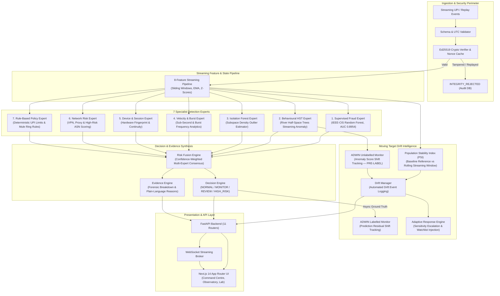

# SHIFT — Final Architecture Report

> **System**: SHIFT — Streaming Hybrid Intelligence for Fraud Tracking  
> **Subtitle**: Adaptive Streaming Fraud Detection & Evidence Forensics Platform  
> **Status**: Verified Production-Ready Build  
> **Date**: 2026-11-06  

---

## 1. Executive Architecture Summary

SHIFT is an enterprise-grade streaming fraud detection intelligence platform designed specifically to solve **"The Moving Target"** problem:

> *"Somewhere in a stream of transactions, a few people are stealing. They read your alerts. At some moment today they will change how they steal, and no one will tell you. Missing one thief costs as much as bothering fifty honest customers. Know when the world changed, before the answers arrive, and say how you know."*

To solve this without fragile single-model reliance or naive auto-retraining, SHIFT implements a **Three-Tier Hybrid Streaming Architecture**:

1. **Deterministic Security & Verification Perimeter**: Ed25519 digital signature cryptographic validation, strict freshness verification, nonces with LRU replay caching, and data provenance enforcement (`IEEE_CIS_HISTORICAL` vs `SYNTHETIC_UPI_SIMULATION`).
2. **Multi-Expert Consensus Intelligence Engine (7 Specialist Models)**: A diverse ensemble of supervised ML, streaming anomaly detection, subspace density estimation, velocity analytics, device continuity, network threat intelligence, and deterministic banking statutory limits.
3. **Dual-Channel Statistical Drift & Forensic Evidence Subsystem**: Unlabelled ADWIN anomaly tracking + labelled error tracking + Population Stability Index (PSI) multi-feature distribution monitoring that detects shifts in adversarial behavior **before ground-truth chargebacks arrive**.

---

## 2. High-Level Architecture Diagram



---

## 3. Technology Stack & Operational Profiles

| Subsystem | Technology | Rationale |
|-----------|------------|-----------|
| **Backend Core** | Python 3.14 / FastAPI / Pydantic v2 | High-throughput async routing, strict runtime type safety, OpenAPI generation |
| **Cryptography** | `cryptography` (Ed25519) | Modern Edwards-curve 25519 signatures; 128-bit security, immune to timing side-channels |
| **Streaming ML** | `river` 0.22 (Half-Space Trees, ADWIN) | Memory-bounded incremental machine learning without model retraining pauses |
| **Tabular ML** | `scikit-learn` / `joblib` (Random Forest) | Pre-trained on 70,000 real-world IEEE-CIS transactions (ROC-AUC 0.8954) |
| **Persistence** | SQLite / SQLAlchemy ORM | Zero-dependency, file-backed atomic transactions, easily upgraded to PostgreSQL |
| **Frontend Framework** | Next.js 14 (App Router) / React 18 / TypeScript | Modern SSR/CSR hybrid, strict component contracts, enterprise layout |
| **Styling & Theme** | Tailwind CSS / Lucide React | Light enterprise white/slate aesthetic, high contrast, zero unnecessary neon |
| **Visualisation** | Apache ECharts | Hardware-accelerated canvas rendering for high-frequency time series and entity graphs |
| **State & Invalidation** | TanStack React Query v5 | Efficient background refetching, cache invalidation on WebSocket broadcast events |

---

## 4. Subsystem Details

### 4.1. Security Perimeter (`security/`)
- **Ed25519 Canonical Signing**: Every incoming transaction event must be signed by the originating device. Canonical JSON serialisation ensures deterministic byte hashes across environments.
- **LRU Nonce Protection**: Retains the last 10,000 unique transaction nonces with TTL expiration to prevent double-spending and replay attacks.
- **Clock Drift Bounds**: Enforces strict UTC timestamps within `MAX_EVENT_AGE_SECONDS = 300s` to block delayed adversary injection.

### 4.2. Streaming Feature Engine (`features/`)
Maintains isolated per-user moving statistics without future leakage:
1. `amount`: Raw monetary payload.
2. `log_amount`: Logarithmic magnitude $\ln(1 + \text{amount})$.
3. `amount_zscore`: Real-time deviation $(x - \mu) / \sigma$ based on the user's historical transactions.
4. `time_since_prev`: Elapsed seconds since previous transaction from same account.
5. `transaction_velocity`: Sliding window count of transactions per minute.
6. `device_consistency`: Cosine/similarity score of device fingerprint history.
7. `session_consistency`: Multi-session collision and hijack detection score.
8. `network_risk_flag`: Categorical indicator for VPN, TOR, or high-risk ASNs.

### 4.3. Multi-Expert Risk Fusion (`engine/risk_fusion.py`)
Rather than relying on a single fallible model, SHIFT computes a confidence-weighted consensus:
$$\text{Score}_{\text{Fused}} = \frac{\sum_{i=1}^{7} w_i \cdot c_i \cdot s_i}{\sum_{i=1}^{7} w_i \cdot c_i}$$
where $w_i$ is the expert default weight, $c_i$ is the dynamic confidence, and $s_i$ is the normalized risk score $[0, 1]$. Any expert that detects severe statutory violations (e.g. Mule ring receiver, signature tampering) can escalate the fused decision immediately.

### 4.4. Moving Target Drift Intelligence (`drift/`)
- **Unlabelled Anomaly ADWIN**: Monitors the mean of the streaming anomaly scores. When fraudsters pivot and transactions deviate from normal behaviour, ADWIN cuts its sliding window and flags drift **immediately**, before any chargeback or victim notification.
- **Population Stability Index (PSI)**: Evaluates 10-bin distribution divergence:
  $$\text{PSI} = \sum_{b=1}^{B} (P_b - Q_b) \cdot \ln\left(\frac{P_b}{Q_b}\right)$$
  Tracks individual features (`amount`, `velocity`, `time_since_prev`). Identifies **which** features changed and **how** they shifted.

---

## 5. Deployment Topology

The entire application runs locally on standard CPU hardware with zero external cloud dependencies:

```
[Port 3000] Next.js Frontend  <--->  [Port 8000] FastAPI REST + WS  <--->  [Disk] SQLite (driftguard.db)
                                                                    <--->  [Disk] Saved Models (*.joblib)
                                                                    <--->  [Disk] Reports (*.json, *.md)
```

No Docker, Kubernetes, Kafka, or Redis is required for full operation.

